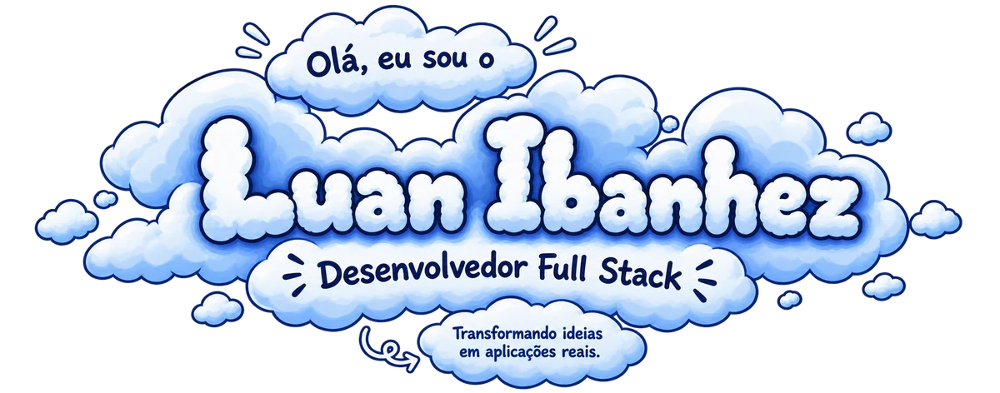
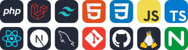
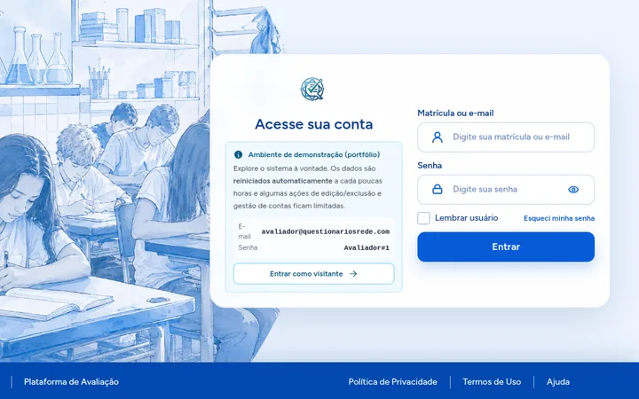
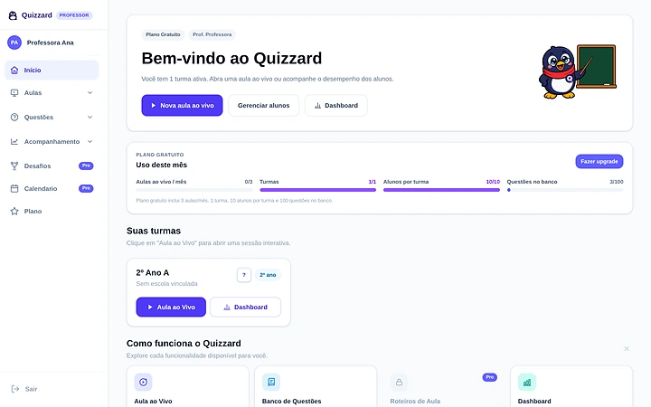
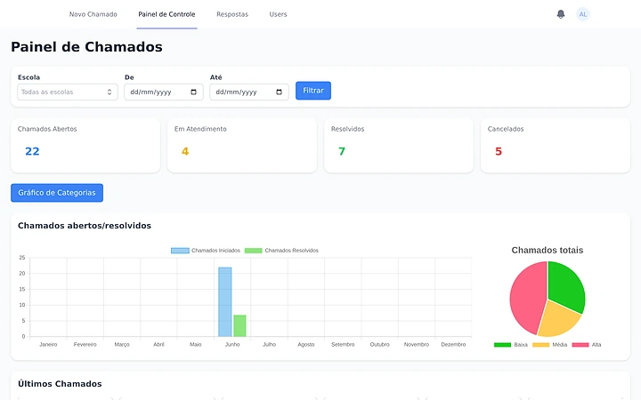
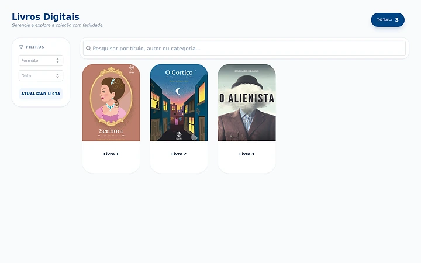
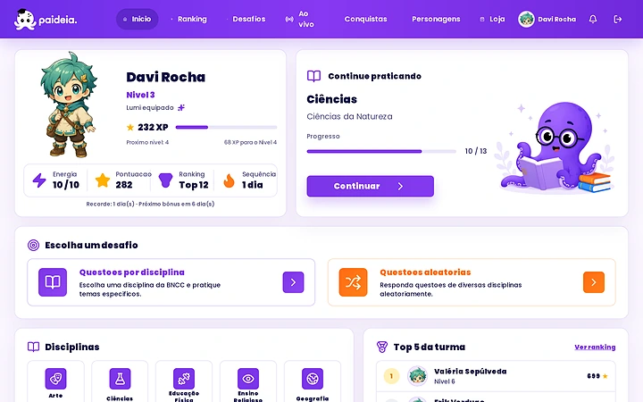
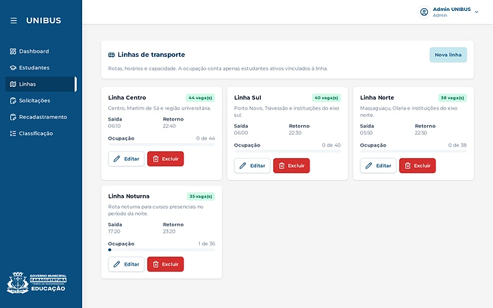
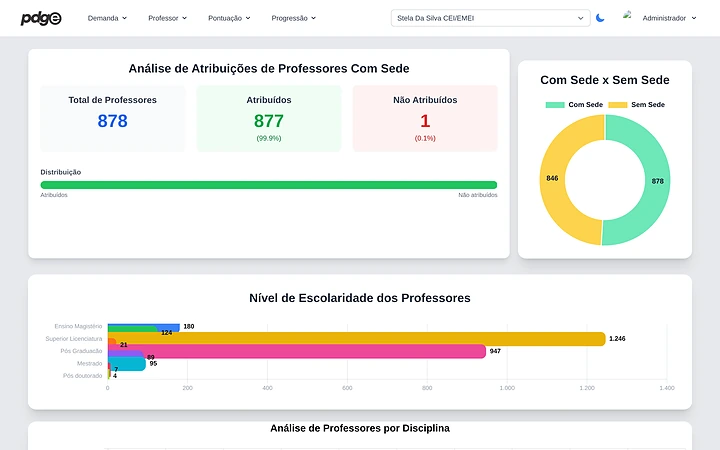
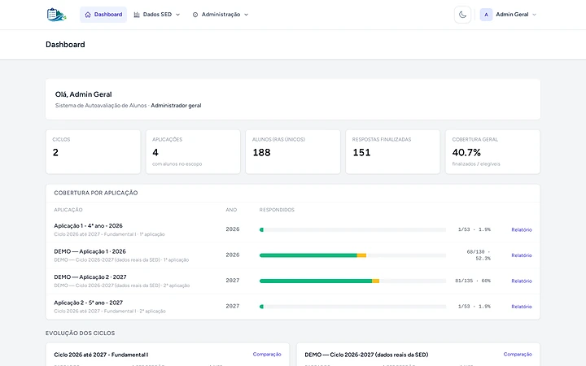

  

  
  
  
  

Desenvolvedor Full Stack com foco em PHP e Laravel, de Caraguatatuba (SP). Sou estagiário na Secretaria de Educação de Caraguatatuba desde outubro de 2024 e aluno de Análise e Desenvolvimento de Sistemas no IFSP.

- **AvaRede:** sou o autor principal do sistema de avaliação das 32 escolas de Ensino Fundamental da rede municipal. Em 2026 foram ~11 mil alunos, 25 mil folhas de resposta e ~550 mil questões corrigidas automaticamente.
- **Gestão Escolar:** estou à frente do backend da reescrita, uma API em Laravel com Sanctum, papéis e permissões com Spatie, trilha de auditoria e 88 arquivos de teste. Ela vai atender 63 unidades e ~21 mil alunos a partir de janeiro de 2027.
- **Hackathons:** 3º lugar no 1º Hackathon da Secretaria de Educação de Caraguatatuba (nov/2025) e backend do Paideia no Hackathon IFSP 2026.
- **Ensino:** ministrei minicursos de PHP, Laravel, MVC, Tailwind CSS e HTML no IFSP em 2026.

 

## Stack

  

Também uso Livewire, Alpine.js, TallStackUI, Sanctum, Reverb (WebSocket), Spatie Permission, Pest, PHPUnit e Scribe.

## Projetos

<table>
  <tr>
    <td width="50%" valign="top">
      
       <strong><a href="https://questionarios-rede.luanibanhez.tech/">AvaRede</a></strong>
       Avaliações da rede municipal: as escolas lançam o gabarito por foto, PDF ou câmera do celular, as notas são calculadas automaticamente e os resultados viram gráficos por aluno, turma, escola e habilidade.
       Laravel · Livewire · TallStackUI · MySQL
    </td>
    <td width="50%" valign="top">
      
       <strong><a href="https://quizzard.luanibanhez.tech/">Quizzard</a></strong>
       SaaS de perguntas e respostas gamificado para crianças de 6 a 10 anos, com aulas ao vivo e dificuldade que se adapta a cada aluno. Multi-tenant, com plano gratuito e pago.
       Next.js · Laravel · Reverb · Redis
    </td>
  </tr>
  <tr>
    <td width="50%" valign="top">
      
       <strong><a href="https://chamados.luanibanhez.tech/">HelpEduc</a></strong>
       Chamados de TI das escolas, com chatbot que guia a abertura do chamado, painel por status, período e categoria e notificações em tempo real.
       Laravel · Livewire · Reverb · MySQL
    </td>
    <td width="50%" valign="top">
      
       <strong><a href="https://livrodigital.luanibanhez.tech/">LivroDigital</a></strong>
       Biblioteca pública que transforma o PDF enviado em flipbook com animação de folhear e zoom, com busca, filtros e download.
       Laravel · Livewire · Alpine.js · Turn.js
    </td>
  </tr>
  <tr>
    <td width="50%" valign="top">
      
       <strong><a href="https://bugnoanzol.hyanferreira.com.br/">Paideia</a></strong>
       Gamificação com questões da BNCC, XP, missões e desafios ao vivo entre colegas. Feito em equipe em 30 horas no Hackathon IFSP 2026; fiz a maior parte do backend.
       Laravel · Sanctum · Reverb · Next.js
    </td>
    <td width="50%" valign="top">
      
       <strong><a href="https://sigtu.luanibanhez.tech/">SIGTU</a></strong>
       Gestão de transporte universitário: inscrição, recadastro, lista de espera e ocupação das linhas. Projeto em equipe no IFSP, em que fui tech lead do backend.
       Laravel · Sanctum · Next.js · PHPUnit
    </td>
  </tr>
  <tr>
    <td width="50%" valign="top">
      
       <strong>PDGE</strong>
       Cadastro de professores com cálculo automático da pontuação usada na atribuição de aulas e na remoção.
       Laravel · Livewire · Chart.js · Laravel Excel
    </td>
    <td width="50%" valign="top">
      
       <strong>Autoavaliação</strong>
       Questionário online ou em folha com QR Code que vira indicadores como nível socioeconômico e acesso digital, comparando o mesmo aluno em dois anos.
       Laravel · Livewire · Tailwind CSS · DomPDF
    </td>
  </tr>
</table>

Os links abrem as demos. O código da maioria desses sistemas fica em repositórios privados.

 

<picture>
  <source media="(prefers-color-scheme: dark)" srcset="https://raw.githubusercontent.com/luaniban/luaniban/output/github-snake-dark.svg">
  
</picture>
